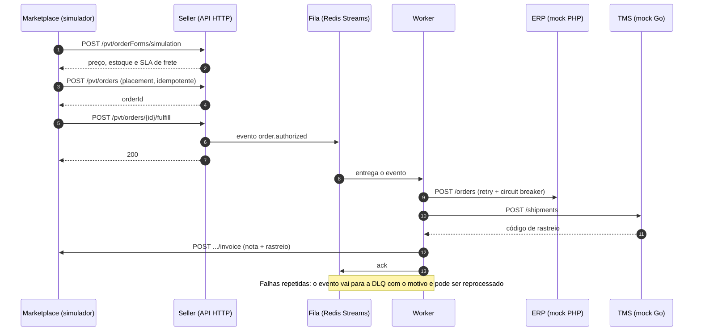
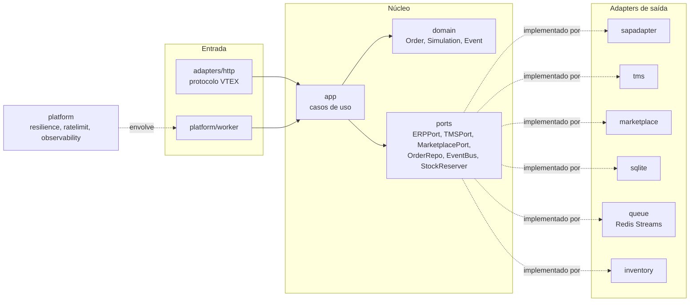

# Seller externo VTEX em Go

[](https://github.com/fabriciossouza/poc-vtex-seller-go/actions/workflows/ci.yml)

Prova de conceito de um seller externo para marketplace VTEX, escrito em Go com arquitetura hexagonal. O serviço implementa o protocolo de seller externo (simulação de carrinho, criação de pedido, autorização de despacho e cancelamento), repassa o pedido a um ERP e a um TMS por uma fila e devolve a nota com o rastreio ao marketplace, com idempotência, retry, circuit breaker e DLQ (fila das mensagens que falharam, para reprocessar depois).

**Aviso: o marketplace deste projeto é um simulador que segue o contrato documentado em developers.vtex.com. Não é uma loja VTEX real, e nenhuma chamada sai para a VTEX.** Os payloads de referência e a fonte de cada um estão em [`testdata/FONTES.md`](testdata/FONTES.md). O ERP é um mock em PHP e o TMS é um mock em Go.

- Demo: https://vtex.fabriciosouza.duckdns.org
- Documentação da API (OpenAPI/Swagger): https://vtex.fabriciosouza.duckdns.org/docs

O estado da demo é limpo sozinho a cada hora e pelo botão "Resetar a demo". O uso é limitado por IP (resposta 429).

## Fluxo



## Arquitetura hexagonal



A regra de dependência é verificada por teste: [`internal/hexagonal_test.go`](internal/hexagonal_test.go) falha se `domain`, `ports` ou `app` importarem um adapter ou `platform`, ou se um adapter importar outro.

| Pasta | Papel |
|---|---|
| `internal/domain` | Entidades e regras (pedido, simulação, eventos). Não importa nada do projeto. |
| `internal/ports` | Interfaces que o núcleo precisa e erros tipados. |
| `internal/app` | Casos de uso: `SimulateCart`, `PlaceOrder`, `FulfillOrder`, `CancelOrder`, `DispatchToERP`. |
| `internal/adapters` | `http` (protocolo VTEX), `sapadapter`, `tms`, `marketplace`, `sqlite`, `queue`, `inventory`. |
| `internal/platform` | `worker`, `resilience` (retry e breaker), `ratelimit`, `observability`. |
| `internal/demo` | Simulador de marketplace, linha do tempo por pedido e controles do painel. |
| `internal/web` | Painel, `/docs` e Swagger UI sem CDN. |
| `mocks/sap-adapter-php` | Mock do ERP em PHP com falha e latência configuráveis. |
| `cmd/seller`, `cmd/tms-mock`, `cmd/demo` | Binários: serviço, mock do TMS e verificador dos 4 cenários. |

## Onde cada requisito aparece no código

| Requisito | Onde | Como funciona |
|---|---|---|
| Idempotência | `internal/app/place_order.go`, `internal/adapters/sqlite/repo.go` | O `marketplaceOrderId` é a chave de idempotência (índice único). Um placement repetido devolve o pedido existente e não reserva estoque de novo. `fulfill` repetido republica o evento e responde 200. ERP e TMS recebem o header `Idempotency-Key`. |
| Concorrência otimista | `internal/adapters/sqlite/repo.go`, `internal/domain/order.go` | `Order.Version` é conferida no `UPDATE`. Uma escrita com versão antiga devolve `ports.ErrVersionConflict` (409), tratado como transitório pelo retry. Um cancelamento confirmado não é sobrescrito por escrita concorrente. |
| Retry com backoff e jitter | `internal/platform/resilience/retry.go` | Backoff exponencial limitado por `MaxDelay`, com jitter entre 50% e 100% do atraso. Só repete erro transitório (5xx, timeout, conexão); 4xx é permanente. Padrão: 4 tentativas, base de 200 ms. |
| Circuit breaker | `internal/platform/resilience/breaker.go` | Fechado, aberto e meio-aberto, com estado observável. Abre após 3 falhas transitórias seguidas, rejeita por 8 s e deixa passar uma chamada de teste. |
| DLQ e replay | `internal/adapters/queue/bus.go`, `internal/platform/worker/worker.go` | Esgotadas as tentativas, o evento vai para um stream de DLQ com motivo, número de tentativas e horário. `ReplayDLQ` reprocessa pelo mesmo retry e breaker, é serializado e descarta cartas malformadas ou de pedido em estado terminal. Mensagens sem ack são reassumidas por outro consumidor depois de `ClaimIdle`. |
| Rate limit | `internal/platform/ratelimit` | Token bucket por IP (padrão 10 req/s, rajada de 30), 429 com `Retry-After`. IPv6 é agrupado por /64 e o mapa de clientes tem teto de 10 mil chaves. O cabeçalho `X-Forwarded-For` só vale vindo de proxy confiável (`TRUSTED_PROXIES`); se esse proxy mandar um valor inválido, a resposta é 400, nunca o balde compartilhado do proxy. O retorno interno da nota (`/demo/mkt/`) não conta no limite, mas só quando vem direto da rede interna (`INTERNAL_NETS`) e sem cabeçalho de proxy. |
| Quality gates | `.github/workflows/ci.yml`, `.golangci.yml` | `go test -race` com cobertura mínima, golangci-lint (govet, errcheck, staticcheck, ineffassign, unused, gosec), gosec com SARIF, govulncheck, gitleaks, integração com Redis 7 e teste do mock PHP. |
| Observabilidade | `internal/platform/observability` | Log JSON estruturado por requisição, métricas Prometheus por rota em `/metrics` (o rótulo de rota é o padrão do mux e métodos fora da lista padrão viram `OTHER`, para a cardinalidade ser finita; inclui estado do breaker e tamanho da DLQ por `XLEN`) e `/healthz` que consulta o Redis. |
| Defesas de entrada | `internal/adapters/marketplace/client.go`, `internal/adapters/http`, `internal/domain/order.go` | O `marketplaceServicesEndpoint` vem do chamador e só é aceito se o host estiver na allowlist (proteção contra SSRF); sem redirect. `marketplaceOrderId` e SKU seguem `[A-Za-z0-9-]` com 40 e 20 caracteres no máximo (pontos e barras são recusados). Limite de 50 itens e de tamanho de corpo. O domínio recusa quantidade não positiva, preço negativo e overflow do total. |

Os contratos entre o seller, o ERP, o TMS e a fila estão em [`docs/contratos-internos.md`](docs/contratos-internos.md).

## Os 4 cenários do painel

O painel (`/`) tem um botão por cenário e mostra a linha do tempo de cada pedido, o estado do breaker, o conteúdo da DLQ e o estoque.

1. **Pedido duplicado.** Envia o mesmo `marketplaceOrderId` duas vezes. Prova a idempotência: o seller devolve o mesmo `orderId` e o estoque é reservado uma vez.
2. **Derrubar o ERP.** Com o mock do ERP falhando, o worker repete com espera crescente, o breaker abre e o evento vai para a DLQ com o motivo.
3. **Religar e reprocessar.** Depois de religar o ERP e esperar o breaker voltar a testar, reprocessar a DLQ conclui o pedido, e o ERP o registra uma única vez.
4. **Fluxo feliz.** Simulação, pedido, autorização, ERP, TMS e nota com o rastreio de volta ao marketplace, na ordem causal.

`make demo` roda os mesmos quatro cenários contra o compose e falha se algum resultado divergir.

## Como rodar

Requisito: Docker com Compose. Go e PHP não precisam estar instalados; os testes rodam em contêiner.

```sh
make up     # sobe seller, ERP (PHP), TMS e Redis; painel em http://127.0.0.1:8094
make demo   # sobe a stack e executa os 4 cenários de ponta a ponta
make test   # testes Go (com -race e cobertura) e teste do mock PHP
make test-integration  # fila contra um Redis real
make down   # derruba tudo e limpa o estado
```

A porta é publicada só em `127.0.0.1` (variável `PORT`). Os contêineres rodam com sistema de arquivos somente leitura, sem capabilities, com o estado em tmpfs de 64 MB, limites de memória e de processos e logs rotacionados (10 MB, 3 arquivos). As variáveis de ambiente do seller estão em [`cmd/seller/config.go`](cmd/seller/config.go).

O compose tem duas redes de sub-rede fixa: a de ingresso (`172.30.0.0/24`, gateway `172.30.0.1`), onde fica a porta publicada, e a `backend` (`172.30.1.0/24`, `internal: true`, sem rota para fora), onde ficam Redis, ERP e TMS. Só o seller está nas duas. Duas variáveis dependem dela:

- `TRUSTED_PROXIES` (padrão `172.30.0.1/32`): CIDRs de proxies reversos cujo `X-Forwarded-For` é aceito para identificar o cliente. O padrão é o gateway da ponte, que é o endereço que o seller enxerga quando um proxy no host acessa `127.0.0.1:${PORT}`. Sem isso, todos os visitantes dividem o limite do proxy.
- `INTERNAL_NETS` (padrão `172.30.0.0/24,172.30.1.0/24`): redes de onde `/demo/mkt/` (o retorno da nota) é aceito e isento do limite, desde que a requisição não tenha cabeçalho de proxy (`X-Forwarded-For`, `Forwarded`, `X-Real-Ip`, mesmo vazio) e a origem não seja um proxy confiável (o gateway nunca conta como interno).

Exemplo com outro proxy: `TRUSTED_PROXIES=172.30.0.1/32,10.1.0.0/16 make up`.

## Rollout Blue/Green e Canary em produção

Isto não está implementado neste repositório; é o plano que seria seguido.

**Pré-requisitos.** O serviço precisa conviver em duas versões ao mesmo tempo: o estado fica fora do processo (hoje sqlite em tmpfs, em produção um banco compartilhado), o consumer group do Redis Streams já permite que instâncias de versões diferentes dividam a fila, e mudanças de schema seguem expandir, migrar e contrair, para que a versão antiga continue funcionando com o schema novo.

**Blue/Green.**
1. Subir o ambiente verde com a versão nova, apontando para o mesmo banco e o mesmo Redis, sem receber tráfego do marketplace.
2. Rodar nele o teste de fumaça (`/healthz` e os 4 cenários com `make demo` apontado para o ambiente).
3. Pausar o consumo do azul na fila (ou deixar os dois no mesmo consumer group) para não haver dois conjuntos de workers com regras diferentes por muito tempo.
4. Trocar o roteamento (balanceador ou DNS com TTL baixo) para o verde.
5. Manter o azul de pé por uma janela de observação. Rollback é a troca inversa do roteamento; como os eventos pendentes estão na fila e os pedidos no banco, nada se perde.
6. Passada a janela, desligar o azul.

**Canary.**
1. Direcionar uma fração pequena do tráfego (por exemplo 5%) para a versão nova, por peso no balanceador ou por seller.
2. Comparar com a versão estável, por 15 a 30 minutos, a taxa de 5xx, a latência p95 por rota, o tamanho da DLQ, as falhas seguidas do breaker e os conflitos de versão.
3. Subir em degraus (5%, 25%, 50%, 100%) só se os indicadores ficarem dentro do limite combinado; qualquer desvio volta o peso a zero.
4. Como a idempotência está no `marketplaceOrderId`, um pedido repetido pelo marketplace durante a troca de versão não duplica nada.

## Limitações conhecidas

- A simulação repete a cotação de frete por item, em vez de agrupar por SLA e destino.
- O SLA de entrega é fixo (cotação do TMS mock com prazo constante).
- Reset, derrubar o ERP e cancelar pedidos afetam todos os visitantes ao mesmo tempo; a demo é compartilhada e não há isolamento por sessão.
- O `price` do placement não é conferido com o catálogo do seller; o valor enviado pelo marketplace é gravado como veio.
- Com o breaker aberto, o worker não tenta o ERP e manda as mensagens novas direto para a DLQ com o motivo. É o comportamento mostrado no cenário 2, e o reprocessamento depende de o breaker voltar a testar.
- `/metrics` é público nesta demo, sem autenticação. Os rótulos têm cardinalidade limitada e as métricas não trazem dados de pedido.
- Os endpoints `/pvt` não têm autenticação nesta demo. Em produção, o marketplace se autenticaria (por exemplo com as chaves da VTEX) e a rede restringiria a origem.
- Existe um único circuit breaker para todas as dependências (ERP, TMS e notificação ao marketplace). Uma dependência lenta abre o breaker para as outras.
- A nota é reenviada quando o evento é reentregue; o marketplace responde 409 e o seller trata como sucesso.
- Não há outbox: a gravação do pedido e a publicação do evento não são atômicas. Se a publicação falhar depois do commit, o `fulfill` repetido republica o evento, mas não há varredura automática.
- OpenTelemetry não foi implementado. A observabilidade se limita a logs JSON, `/metrics` e `/healthz`; não há traces.
- Um reset concorrente com um despacho em andamento pode deixar uma carta órfã na DLQ.
- O estado (sqlite e Redis) fica em tmpfs e se perde ao reiniciar os contêineres.

## Licença

MIT. Veja [`LICENSE`](LICENSE).
